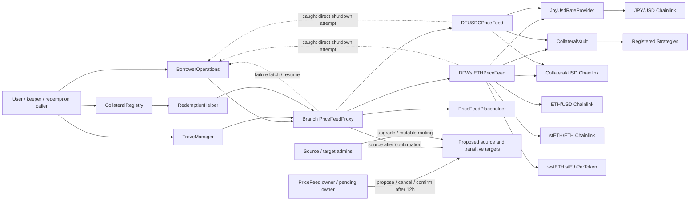

# Final Production Source-Level Price And Control Topology

This graph is the source-level circularity analysis for final candidate
`1b453c10e3378390109cf42037a97b7f6de57b9e` / `contracts/src` tree
`84476d9086e89580c58918b203f4142ecd839765`. The on-chain
`PriceFeedProxy.source()` marker is intentionally shallow and is not part of the
acyclicity proof. Exact deployed addresses, runtime code hashes, immutable
bindings, mutable routing, and administrators are not available in a
source-only package; the deployment-bound graph remains a launch gate.

## Candidate source topology

The expected Day-1 topology gives each branch its own proxy and source. Active branch 0 uses
`DFWstETHPriceFeed`; active branch 1 uses `DFUSDCPriceFeed`; reserved branches
use `PriceFeedPlaceholder` until their separately reviewed source is bound.

## Edge ledger

| From | To | Calls / data | Can call back into a price path? |
| --- | --- | --- | --- |
| BorrowerOperations | registered PriceFeedProxy | `fetchPrice()` for open/adjust, shutdown checks, and recovered risk-reducing flows | No call is made while BO holds a callback-sensitive lock; returned `failure=true` is not used for terminal shutdown. |
| TroveManager | registered PriceFeedProxy | normal, redemption, and urgent fetches | Consumer only; no target-controlled registration change. |
| RedemptionHelper / CollateralRegistry flow | each registered branch proxy | `fetchRedemptionPrice()` with no `try/catch` | Consumer only; one broken branch can fail system redemption, which is why every source path is smoke-tested. |
| PriceFeedProxy | configured source type | `fetchPrice`, `fetchRedemptionPrice`, `fetchUrgentRedemptionPrice`, `lastGoodPrice`, and provenance getter | The candidate source implementations do not reference the proxy. A future source must be recursively reviewed. |
| PriceFeedProxy | BorrowerOperations | `shutdownFromOracleFailure`, `isOracleFailureShutdown`, `resumeFromOracleFailure` | These BO functions read/write pause state and do not fetch a price, so this edge terminates. |
| DFWstETHPriceFeed | four market/rate inputs | direct stETH/USD; ETH/USD; stETH/ETH; wstETH canonical rate | These external target types do not depend on JPYdf contracts in the expected Day-1 topology; exact bindings remain launch evidence. |
| DFWstETHPriceFeed | JpyUsdRateProvider | accepted JPY/USD rate and timestamp | Provider calls only its pinned Chainlink aggregator. |
| DFWstETHPriceFeed | CollateralVault | `backingRatioForPricing()` | The Vault reads assets, liabilities, and Strategy valuations; it does not call a price feed or proxy. |
| DFUSDCPriceFeed | USDC/USD, JpyUsdRateProvider, CollateralVault | normal/redemption/urgent quote inputs | Same terminating dependencies as above. |
| DF feed source | BorrowerOperations | best-effort direct shutdown signal | Behind the proxy this fails BO's `msg.sender == priceFeed` check and is caught. The proxy then performs the authorized latch. BO's setter does not fetch a price. |
| CollateralVault | registered Strategies | live conservative valuation and allocation/deallocation | Reviewed Strategy types do not route to Branch PriceFeedProxy. Exact venue bindings and mutable state remain launch evidence. |
| PriceFeedPlaceholder | none | all three paths return the valid `(1e18, false)` sentinel with current synthetic JPY provenance | The source itself does not fail; the reserved branch is economically unusable through Vault/dToken/cap guards. No outgoing dependency. |
| PriceFeed owner | proposed source / Proxy lifecycle | `proposeSource`, `cancelSourceProposal`, `confirmSource`, emergency confirmation, and two-step ownership | A privileged source change can introduce a semantic cycle; the delay/smokes do not validate the graph. Exact owner and pending-owner state remain launch evidence. |
| Source/target administrators | proposed source dependencies | upgrades, resolver changes, routing, or target replacement | Every mutable edge and administrator must be included in the deployment-bound trace. |

There is no `delegatecall` in the price indirection. `PriceFeedProxy` is a fixed
contract that calls an external source; it is not a storage proxy.

## Acyclicity conclusion

For the final candidate source topology, every path leaving a PriceFeedProxy terminates
at a source, Chainlink/wstETH input, the JPY provider, the Vault/Strategy
valuation boundary, or a BO pause setter that does not fetch a price. No path
returns to the originating proxy. Current production and placeholder sources do
not forward to another `IPriceFeed`.

This conclusion is about the reviewed contract classes and configured source
types, not about an as-yet-unrecorded production deployment. It does not prove
that an arbitrary future source is safe, that a mutable target still has the
reviewed binding, or that production bytecode matches this package.

At deployment, bind this topology to the actual Proxy/source/dependency
addresses, runtime code hashes, immutable constructor bindings, implementation
addresses, mutable routing state, and administrators at one pinned block. An
independent reviewer must reject unknown or cyclic edges. Until that evidence is
recorded, deployment-bound acyclicity is pending.

## Why acceptance smoke calls do not prove this graph

`confirmSource` smoke-calls the proposed source before assigning
`source = proposedSource`. A forwarding proposed source can call back into the
proxy during validation; that callback still delegates to the old source and
can return the same price, allowing all three smoke paths and deviation checks
to pass. The 12-hour lifecycle, source address, source codehash, and successful
smoke calls therefore provide notice and liveness evidence, not circularity
evidence. No callback latch was added.

## Required trace procedure for every future source

Before `proposeSource`:

1. Pin the candidate address, runtime code hash, constructor arguments, owner,
   and every external target/code hash reachable from `fetchPrice`,
   `fetchRedemptionPrice`, `fetchUrgentRedemptionPrice`, `lastGoodPrice`, and
   `jpyUsdRateProvider`.
2. Expand every call recursively, including fallback functions, routers,
   adapters, upgradeable implementations, registries, and semantic forwarding
   not visible from the ABI.
3. Reject any path that reaches the branch proxy, another branch proxy, a core
   consumer that can fetch the branch price, or a mutable resolver that can be
   changed to such a path.
4. Model callbacks during construction and confirmation with the old source
   still assigned. Passing the three smoke calls is not an acceptable substitute.
5. Record the reviewed graph, code hashes, trace owner, and exact evidence in
   the source-change proposal before the 12-hour clock begins. Re-run at
   confirmation and cancel if any code or dependency changed.

The bound dependency graph and this recursive trace are the only evidence that
can negate semantic forwarding/cycles. This document supplies the source-level
topology and procedure; deployment evidence supplies the missing addresses and
state. The depth-one `source()` marker merely rejects a directly proxy-shaped
candidate.
