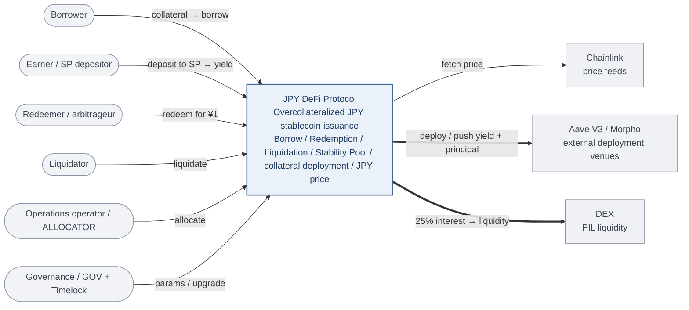
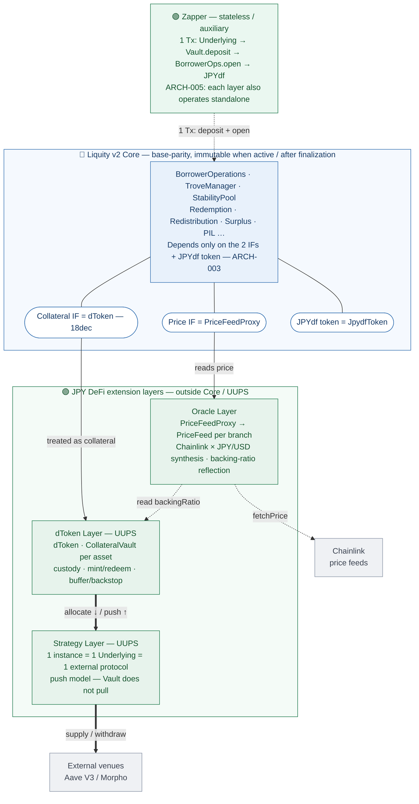

# 📋 Product Overview (System Specification)

> Support translation. The Japanese source document
> [`documents/jp/protocol/product/Product-Overview.md`](../../../jp/protocol/product/Product-Overview.md)
> is authoritative if this file conflicts with it.

## 0. Metadata

| Item | Value |
| --- | --- |
| Status | Draft (being formalized as the source of truth for the system-level specification) |
| Domain | Protocol |
| Lifecycle | Evergreen |
| Artifact Type | Spec |
| Decision Authority | Protocol Governance |
| Maintainer | DeltaForesight |
| Visibility | Repository |
| Normative Source | This document for `SYS-FR`, `SYS-CON`, `SYS-NFR`, `SYS-INV`, and `ARCH`. The launch risk gate and architecture decisions are separate artifacts |
| Target system | JPY DeFi protocol (🔵 Liquity v2 Core + 🟢 dToken / Strategy / Oracle / Zapper) |
| Document role | **System Requirements Specification (SyRS) + architecture description**. Source of truth positioned between higher-level requirements (investor-facing overview) and lower-level component requirement specifications (`dToken.md`, etc.) |
| Related documents | Lower-level component specs (§15) / [Architecture Decision Records](architecture/Architecture-Decision-Records.md) / [Mainnet Launch Risk Gate](../launch/gates/Mainnet-Launch-Risk-Gate.md) / Japanese [Parameter Catalog](../../../jp/protocol/product/parameters/Parameter-Catalog.md) / Day-1 scope [Mainnet Launch Product Decision Record](../launch/decisions/Mainnet-Launch-Product-Decision-Record.md) / Day-1 values [Parameters.md](../../Parameters.md) / core inheritance specification [Liquity-v2-Core-Spec.md](spec/Liquity-v2-Core-Spec.md) |

> This document covers system-wide **requirements, constraints, principles, invariants, and trust boundaries**, assigning each a persistent ID (`SYS-FR` / `SYS-CON` / `ARCH` / `SYS-NFR` / `SYS-INV`). Separate artifacts are authoritative for the `SYS-RISK` launch gates and `ADR` rationale; §10.1 and §11 are indexes only. Verifiable commitments for individual functions are owned by lower-level component Specs (`DTKN-*` / `VAULT-*`, etc.), and §13 traces to them.
> **Markers**: 🔵 Core (inherited from Liquity v2 with base parity) / 🟡 Modified (limited deltas tracked in the `CORE-MOD-*` ledger) / 🟢 JPY DeFi Extension (added outside Core).

---

## 1. Purpose, Vision, and Scope

JPY DeFi is a **JPY-denominated stablecoin protocol forked from Liquity v2**. It issues the JPY-denominated stablecoin **JPYdf** on an overcollateralized basis using cryptoassets, stablecoins, and similar assets as collateral.

The central design is to inherit Core with base parity and place extensions in layers outside Core: dToken, Strategy, Oracle, and Zapper. §6 (`ARCH`) and §7 (`SYS-FR` / `SYS-CON`) are authoritative for principles and constraints; the [Architecture Decision Records](architecture/Architecture-Decision-Records.md) own the rationale.

- **Protocol scope**: borrowing, Redemption, liquidation, Stability Pool, external collateral deployment and monetization, JPY-denominated oracles, and the bridge-ready `JpydfToken` extension.
- **Out of scope for this document**: the chain, branch, or bridge route enabled in a particular release; governance-token tokenomics; and investor-facing market analysis.
- **Release-specific scope and values**: The [Mainnet Launch Product Decision Record](../launch/decisions/Mainnet-Launch-Product-Decision-Record.md) owns Day-1 public branches and feature scope, [Parameters.md](../../Parameters.md) owns parameter values, and deployment Manifests / Evidence own actual wiring and state. This document does not define those mutable values.

---

## 2. Stakeholders and Concerns

| Stakeholder | Primary concerns | Main layers touched |
| --- | --- | --- |
| **Borrower** | Deposit collateral and borrow JPYdf (completed in 1 Tx); avoid liquidation | 🟢 Zapper -> 🟢 dToken -> 🔵 Core |
| **dToken holder** | Burn dToken and withdraw Underlying (delayed redemption if buffer is insufficient) | 🟢 dToken Layer |
| **Earner (SP depositor)** | Deposit JPYdf into the SP and earn 75% of borrowing interest plus liquidation gains. Collateral deployment yield is not part of the current SP reward | 🔵 Core (Stability Pool) |
| **Redeemer (arbitrageur)** | Exchange JPYdf for ¥1 worth of collateral and arbitrage the peg | 🔵 Core (Redemption) |
| **Liquidator** | Liquidate undercollateralized Troves and earn execution rewards | 🔵 Core (TroveManager) |
| **Operations operator (ALLOCATOR)** | Allocate Underlying to Strategies and recover yield to the Vault | 🟢 dToken (Vault) + 🟢 Strategy |
| **Governance (GOV multisig / Timelock)** | Control parameters, whitelists, upgrades, and oracle sources | Administrative operations across all layers (GOV operations go through the Timelock in principle) |
| **Governance participant (if a token is adopted)** | T1 authority over Strategy, Treasury, and similar surfaces is not delegated to token voting | 🔵 Core (PIL) + governance-token extension |
| **Auditor / contributor** | Verify trust boundaries, invariants, and the Core parity / delta boundary | This document §9 / §10 + component Specs |

---

## 3. System Context

To preserve Core parity / the delta boundary, JPY DeFi depends on only **two generic interfaces from the core's perspective**: collateral ERC-20 and price feed. The external systems trusted by the extension layers are below.

> **Legend**: solid (→) = use / call / fetch · thick (⇒) = fund flow. **Left** = users and economic actors (§2) / **center** = JPY DeFi Protocol / **right** = external systems.

- **Trusted external systems**: Chainlink, the Lido wstETH contract used for the dwstETH canonical rate, approved Strategy venues, and DEXs used by PIL. See §10 for the strength of each trust assumption.

---

## 4. System Components

### 4.1 Tokens

- **JPYdf (JPY-denominated stablecoin)** — Core's debt token. Core `mint` / `burn` authority is separate from bridge `bridgeMint` / `bridgeBurn` authority.
- **🟢 dToken (collateral beneficial-interest token, ERC-20, 18dec)** — a **1:1 principal claim** on deposited Underlying. Core sees a plain 18-decimal collateral ERC-20. Yield from external Strategy deployment belongs to the Protocol rather than the borrower and is disclosed in the borrowing UI. If a Strategy impairment reduces backing, the Oracle reflects the Vault backing ratio downward in collateral price. Underlying-native appreciation remains in borrower collateral value and is treated separately from external Strategy yield. See [dToken](spec/dToken.md), [Oracle](spec/Oracle.md), and [CollateralVault](spec/CollateralVault.md).
- **Governance token (working name DFT; issuance undecided)** — issuance is not assumed. The Japanese [Governance Token Design](../../../jp/protocol/roadmap/initiatives/governance-token/Governance-Token-Design.md) is authoritative for whether, how, and when to issue it, the binding-vote authority boundary, and the G1–G5 preconditions.

### 4.2 🔵 Liquity v2 Core Logic (Inherited Without Modification, Summary)

> The following is a **reader-friendly summary** of mechanisms inherited from the core. The normative specification is [Liquity-v2-Core-Spec.md](spec/Liquity-v2-Core-Spec.md) (this document does not respecify the core as DF requirements).

- **Branch (per-collateral market)** — an independent market per collateral. Each branch has its own Stability Pool / TroveManager / PriceFeed / liquidation parameters, preventing risk from propagating to other branches (subject to the isolation limits in SYS-INV-004).
- **Trove (borrowing position)** — an NFT-based position where collateral is deposited to borrow JPYdf. Multiple Troves can be held and transferred.
- **User-set Interest Rate** — borrowers freely set APR (lower APR increases Redemption risk). **Borrowing Fees** deter extremely low APR settings.
- **Delegation** — APR adjustment and collateral operations can be delegated. Batch Manager can bundle multiple Troves.
- **Stability Pool (Earn)** — deposits JPYdf to earn 75% of borrowing interest plus liquidation gains. It is the funding source for liquidating undercollateralized Troves.
- **Three-layer liquidation mechanism** — (1) SP Offset (normally completes here) -> (2) JIT (liquidator supplies funds when SP is insufficient) -> (3) Redistribution (last resort: pro rata allocation to healthy borrowers in the same branch).
- **Redemption (autonomous peg correction)** — anyone can exchange 1 JPYdf for ¥1 worth of collateral. Redemption is applied starting from the lowest-APR Troves.
- **PIL (liquidity incentive)** — aggregates 25% of borrowing interest through `InterestRouterForwarder` as the funding source for JPYdf liquidity. When an allocation mechanism is connected, `PILAllocator` distributes it by admin weight to registered initiatives. A Phase-B voting token remains undecided.
- **Safety devices (MCR / CCR / SCR) and Branch Shutdown** — three thresholds for individual liquidation, new borrowing restrictions, and emergency branch shutdown. `TCR < SCR` causes irreversible shutdown and enables Urgent Redemptions. Oracle failure instead enters a recoverable pause: normal redemption and risk-increasing adjustments remain blocked until explicit validated resume. Once the live normal price recovers, liquidation and the economic-shutdown check continue, while collateral additions and debt repayments also reopen so borrowers can defend their positions.

### 4.3 🟢 JPY DeFi Extension Layers (Added "Outside" Core)

Using the core as-is creates the following structural constraints for a JPY-denominated CDP (all solved "outside" the core while preserving Core parity / the delta boundary; rationale in ADR-001/002):

| Core constraint | Layer that solves it |
| --- | --- |
| Collateral cannot be deployed externally (assumed to remain inside the protocol) | -> dToken Layer + Strategy Layer |
| Collateral is assumed to be 18dec (cannot directly handle USDC 6dec, etc.) | -> wrap into 18dec through dToken |
| Per-collateral caps and similar controls are not native | -> dToken mint cap |

1. **dToken Layer** — wraps Underlying into dToken and handles custody, mint/redeem, buffer, backstop, and revenue retention. CollateralVault is also the allocation source and push-return destination for Strategies. -> [dToken](spec/dToken.md) / [CollateralVault](spec/CollateralVault.md)
2. **Strategy Layer** — deploys Underlying allocated by a Vault into an external protocol and **pushes** yield and principal back to the Vault. The default is **1 instance = 1 Underlying = 1 external deployment destination**. Contract requirements live in [Strategy](spec/strategies/Strategy.md).
3. **Oracle Layer** — PriceFeedProxy handles source replacement and combines Chainlink feeds into JPY prices. dToken backing is only a final multiplier; value accounting remains in Vault / Strategy. dwstETH uses the `ORCL-FR-015` market / canonical composite. -> [Oracle](spec/Oracle.md)
4. **Zapper** — a UX Router that aggregates UX complexity into 1 Tx. It is **auxiliary**; other layers operate independently without it (ARCH-005). -> [Zapper](spec/Zapper.md)

### 4.4 Token Bridge Readiness / Release Activation Boundary

`JpydfToken` keeps a bridge-protocol-independent dormant extension to avoid redeployment after token freeze. This document does not fix whether a particular release connects a bridge adapter, message route, or other-chain token; a Launch Decision / Manifest or post-launch activation artifact owns that state.

[JpydfToken](spec/JpydfToken.md) `CORE-BT-*` defines supply authority and dormancy conditions, while [Parameters](../../Parameters.md) `PRM-BRIDGE-MINTER-TIMELOCK` defines the timelock value. The [Bridge Minter Activation Gate](../operations/runbooks/Bridge-Minter-Activation-Gate.md) separately gates minter registration, canary, public route opening, and cap ramp. Registration alone does not enable a user-facing route.

---

## 5. Architecture View

### 5.1 Layer Diagram (Equivalent to C4 Container)

> **Legend**: solid (→) = dependency / call · thick (⇒) = fund flow (allocate · push · supply) · dotted (⇢) = read-only / optional. **Core is a sealed box exposing only its two dependency interfaces (collateral = dToken / price = PriceFeedProxy) plus the JPYdf token**; extensions sit outside (`ARCH-001` / `ARCH-003`). The prose in §4.3, §5.2, and §6.1 defines the layer details.

### 5.2 Key Fund / Data Flows

- **Borrowing**: Underlying -> `Vault.deposit` (dToken mint) -> `BorrowerOperations.openTrove` (collateral=dToken) -> JPYdf issuance. Zapper aggregates this into 1 Tx. Swap-backed repay, close, and Multiply are outside the current canonical ABI and must not be confused with ordinary open, add, withdraw, or close-with-JPYdf operations.
- **Redemption (dToken)**: dToken -> `Vault.redeem` (burn) -> immediate Underlying if buffer is sufficient; otherwise delayed WithdrawRequest -> `claim`.
- **Deployment**: `Vault.allocate` (allocate Underlying to Strategy) -> Strategy deploys externally -> `sendToVault` / `sendProfitToVault` (push yield and principal) -> `transferYieldToTreasury` (send to the treasury specified by the Manifest).
- **Price**: Core -> `PriceFeedProxy.fetchPrice` -> each PriceFeed (Chainlink collateral/USD ÷ JPY/USD, where JPY/USD returns USD per JPY) -> multiply by the dToken backing ratio (`ORCL-FR-014`, common final layer for all collateral) -> JPY-denominated dToken collateral value.
- **backing repair**: recover from Strategy / `writeoffStrategyPrincipal` / `backstopDeposit` to restore actual holdings on the Vault side. `backstopDeposit` increases the protected reserve; to use it as ordinary redeem / claim funding, GOV must explicitly release it with `releaseBackstopToBuffer`. The Stability Pool is not a compensation source; it processes liquidations after the price has been reduced.

---

## 6. Architecture Principles (ARCH)

**Each layer focuses only on its own responsibilities and does not "know" or depend on the internal implementation of other layers.** This is the prerequisite for continuing to use Liquity v2 Core with base parity.

- **ARCH-001 | Core Parity / Ledgered Delta Principle** — Keep changes outside Core as much as possible, centered on replacing the generic interfaces Core already depends on: collateral ERC-20 with dToken and price feed with PriceFeedProxy. Manage permitted differences through the JPYdf canonical surface and `CORE-MOD-*` ledger, and prevent reintroduction of old BOLD public/API names through the Core JPYDF surface guard.
- **ARCH-002 | Separation of Responsibilities** — Each layer is responsible only for its own responsibilities and does not assume other layers' internal implementations. Boundaries:
  - 🔵 **Core** — transfers, accounts, liquidates, and redeems dToken as an ordinary collateral ERC-20. *Does not know*: the Underlying behind dToken, Strategy deployment, or the existence of Zapper.
  - 🟢 **dToken Layer** — Underlying custody, mint/redeem, accounting, liquid buffer, backstop reserve, and revenue transfer to the treasury. *Does not know*: Core logic, Zapper, or **individual Strategy internals** (Strategies are replaceable components accessed through `IStrategy`).
  - 🟢 **Strategy Layer** — only deposit/withdrawal and valuation for one external protocol. *Does not know*: Core, dToken accounting, other Strategies, or Zapper.
  - 🟢 **Oracle Layer** — price fetching, failsafe, and reflection of the dToken backing ratio (ORCL-FR-014). *Does not depend*: the Core assumes no modification and only refers to a fixed `PriceFeedProxy` address. Source replacement is completed inside the Proxy. The backing ratio is **read only** from CollateralVault (VAULT-FR-016); Oracle does not own value accounting. The actor that determines `A < L` is not Oracle but Vault / Strategy accounting denominated in Underlying.
  - 🟢 **Zapper** — only bundles Core and dToken into 1 Tx. It has no state and does not take over responsibilities.
- **ARCH-003 | One-Way Dependencies** — Core's only external dependencies are dToken and PriceFeedProxy. Strategy deployment, Oracle source replacement, and Zapper bundling remain outside and invisible to Core.
- **ARCH-004 | Changes Stay Outside** — Strategy replacement, Oracle source replacement, and Zapper changes never touch Core. Existing JPYdf token `mint` / `burn` paths remain Core-only, while bridge supply is isolated behind `bridgeMint` / `bridgeBurn` and the bridge-minter registry. A Launch or activation artifact approves and records the registered and connected state for a release.
- **ARCH-005 | Zapper Is Auxiliary** — Even without Zapper, Core and the dToken Layer each operate fully on their own. Users can interact directly with each layer without going through Zapper and obtain the same result.
- **ARCH-006 | Explicit Extension Boundary** — Treat future extensions as a UUPS upgrade, setter/whitelist addition, reference switch, or redeployment-scale change. Do not weaken the immutable assumptions of Core wiring, JpydfToken, or CollateralRegistry, or the post-finalization immutability of branch risk parameters.

### 6.1 Extension and Upgrade Boundary

**Add or replace a Strategy destination**

- **Mechanism**: Deploy a new `IStrategy` implementation/proxy and replace it through the Vault whitelist and Strategy setters.
- **Constraints**: Satisfy `1 instance = 1 Underlying = 1 external protocol`, `strategy.underlying() == vault.underlying()`, and the push model. A venue that requires request state in the Vault requires a Vault UUPS upgrade.

**Fix Strategy logic**

- **Mechanism**: UUPS-upgrade the Strategy proxy.
- **Constraints**: Keep `upgrader` separate from Owner and authorize upgrades only through the shared Timelock. Manage storage as append-only / gap-consuming.

**Add Vault / dToken accounting or UX functionality**

- **Mechanism**: Upgrade the applicable UUPS proxy or use an existing setter.
- **Constraints**: Vault upgrades are authorized by `GOV_ROLE`; dToken upgrades are authorized by Owner, with both holders set to the Timelock. Because the dToken `vault` and Underlying binding are fixed during initialization, moving an existing dToken to another Vault or Underlying is not an in-place change and requires a full redeployment and migration. An existing branch cannot be replaced; the [Inert Branch Activation Runbook](../operations/runbooks/Inert-Branch-Activation-Runbook.md) governs opening an inert branch.

**Treasury / user-reward distributors**

- **Mechanism**: Switch revenue destinations through Vault `setTreasury` and `InterestRouterForwarder.setRecipient`. Each component Spec owns the Treasury / distributor functionality and authority boundary.
- **Constraints**: Do not present a distribution route absent from the Manifest and activation gate as an additional SP reward, claimable reward, or fixed APR.

**PIL liquidity incentive (Phase A)**

- **Mechanism**: `DeployPILAllocatorPhaseA` reads JPYdf from `deployment-manifest.json`, deploys `PILAllocator` / `UniV4MerklInitiative`, and records `pil-activation-manifest.json` as Evidence. Connection replaces the final recipient through Timelock / Safe `InterestRouterForwarder.setRecipient(PILAllocator)`. The `PILAllocator` owner is the Timelock, while the Guardian multisig holds immediate pause only. The [Mainnet Launch Product Decision Record](../launch/decisions/Mainnet-Launch-Product-Decision-Record.md) §6 determines which launch package connects it.
- **Constraints**: Phase A does not implement governance-token staking or voting. The Timelock sets registered initiatives and weights; registration is bounded by `MAX_INITIATIVES=32`, active weights total `1e18`, and an inactive allocator is unregistered or zero-weight. Reserve and Treasury allocations are explicit initiatives, and unset, all-zero, or below-threshold PIL carries over in the allocator / initiative. The activation package that approves adoption freezes the Uniswap v4 pool id, Merkl DistributionCreator, campaign threshold, and weights in `pil-activation-manifest.json`. Phase-B binding voting is limited to weights among allowlisted initiatives; the Japanese [Governance Token Design](../../../jp/protocol/roadmap/initiatives/governance-token/Governance-Token-Design.md) owns the voter and authority boundary.

**Replace an Oracle source**

- **Mechanism**: Deploy a new PriceFeed source and replace it through `PriceFeedProxy.proposeSource` / `confirmSource`.
- **Constraints**: PriceFeedProxy is not UUPS. Replacing the proxy address referenced by Core is a branch-redeployment-scale change.

**Enable a Zapper / swap route**

- **Mechanism**: Deploy a new Zapper, Exchange adapter, or asset-specific adapter and switch Manifest and frontend configuration references.
- **Constraints**: Zappers and `IExchange` adapters are stateless, immutable, and non-upgradeable. The current canonical ABI keeps no fail-fast exchange placeholder or flash-close surface, and future additions must not depend on Balancer. A changed v4 venue, hooks, or router assumption requires a new adapter.

**Activate a JPYdf token-only bridge**

- **Mechanism**: Deploy a bridge adapter/minter, call `JpydfToken.proposeBridgeMinter`, wait for the timelock, and call `confirmBridgeMinter`.
- **Constraints**: The [Bridge Minter Activation Gate](../operations/runbooks/Bridge-Minter-Activation-Gate.md) owns cap, rate, pause, accounting, incident response, and route-publication conditions before and after registration. dToken and yield-bearing representations remain outside the initial bridge scope.

**Open a cap-0 branch or activate an inert branch (Branches 2–7)**

- **Mechanism**: Fix the exact Underlying, all six Core risk parameters, Oracle source, Vault operating values, Strategy, SP/liquidator capacity, frontend/ops metadata, and cap in one activation package. For a reserved branch, the common Timelock calls `AddressesRegistry.finalizeRiskParams` exactly once and synchronizes the Registry, BorrowerOperations, and TroveManager in the same transaction. Each branch's Day-1 state and activation conditions follow the [Mainnet Launch Product Decision Record](../launch/decisions/Mainnet-Launch-Product-Decision-Record.md) §1 and the Japanese [Inert Branch Activation Gate](../../../jp/protocol/operations/activation-gates/Inert-Branch-Activation-Gate.md).
- **Constraints**: A reserved branch with `riskParamsFinalized == false` cannot open a Trove or accept a Stability Pool deposit. The bootstrap values in [Parameters.md](../../Parameters.md) are not approval values for the future collateral. Finalization is one-shot and limited to an empty, non-shutdown branch, including zero SP deposits; it cannot be changed or cancelled afterward. Re-derive the selected asset's values under the Japanese [Collateral Parameter Policy](../../../jp/protocol/product/policies/Collateral-Parameter-Policy.md) §2.4 rather than compensating only through a cap or Oracle haircut.

**Add a Core branch or change finalized risk parameters**

- **Mechanism**: Redeploy; do not append to the existing Core.
- **Constraints**: JpydfToken renounces Owner after `setCollateralRegistry`, and CollateralRegistry stores branch composition immutably. A reserved branch's one-shot pre-activation finalization is not a branch addition. Adding, removing, or replacing a branch, changing Core wiring, or changing finalized MCR / CCR / SCR is not an upgrade within the existing system.

---

## 7. System Requirements (SYS-FR / SYS-CON)

System-level functional requirements (SYS-FR) and constraints (SYS-CON). Each SYS decomposes into functional requirements of lower-level components (`*-FR-*`) (§13 traceability).

### Functional Requirements (SYS-FR)

| ID | System functional requirement (Statement) | Main implementation destinations |
| --- | --- | --- |
| **SYS-FR-001** | JPYdf can be **issued overcollateralized** against cryptoassets and stablecoins (including completion in 1 Tx) | 🔵 Core / DTKN-FR-004 / VAULT-FR-001 / ZAP-FR-001..004 |
| **SYS-FR-002** | dToken holders can **redeem principal in kind as Underlying** (delayed redemption + claim if buffer is insufficient) | DTKN-FR-005 / VAULT-FR-002,003,006 |
| **SYS-FR-003** | Collateral (Underlying) can be **deployed into external protocols and monetized as protocol revenue** (push model) | VAULT-FR-004,007 / STGY-FR-001..003,010 / AAVE-FR-* |
| **SYS-FR-004** | The JPYdf **peg can be autonomously corrected** (Redemption / three-layer liquidation / Stability Pool) | 🔵 Core ([Liquity-v2-Core-Spec](spec/Liquity-v2-Core-Spec.md)) |
| **SYS-FR-005** | Collateral prices are obtained **denominated in JPY**, **reflect the dToken backing ratio** (collateral value depegs on Strategy losses; backing repair uses backstop reserve), and degrade through failsafe on feed failure | ORCL-FR-* / VAULT-FR-016..018 / 🔵 Core (lastGoodPrice / oracle pause / economic shutdown) |
| **SYS-FR-006** | `JpydfToken` has a bridge-protocol-independent dormant extension, minter registration/removal, and a separate supply path so an approved bridge can be connected after token freeze. Registration, route opening, and the remote-supply cap are approved separately | `JpydfToken` / Bridge Minter Activation Gate |
| **SYS-FR-007** | Governance can control **parameters, whitelists, upgrades, and oracle sources** | VAULT-FR-008,009,012 / DTKN-FR-006,008,009 / STGY-FR-011 / ORCL-FR-* |
| **SYS-FR-008** | UX can be **aggregated into 1 Tx** (auxiliary; the core continues to operate without it) | ZAP-FR-* |
| **SYS-FR-009** | The PIL portion of borrowing interest can be aggregated, held while inactive, and distributed by admin weight to JPYdf liquidity incentives when Phase-A is active | CORE-AP-FR-007 / IRTR-FR-002,003 / PILA-FR-* |

### Constraints (SYS-CON)

| ID | Constraint (Statement) | Rationale |
| --- | --- | --- |
| **SYS-CON-001** | 🔵 Liquity v2 core keeps base parity while canonicalizing the JPYdf surface (old BOLD public/API names are forbidden; allowed deltas are Core spec §2.2 / §5.1) | ARCH-001 / ADR-001 |
| **SYS-CON-002** | The core depends on only **two external interfaces: collateral ERC-20 (dToken) and price feed (PriceFeedProxy)** | ARCH-003 |
| **SYS-CON-003** | Collateral is **18dec ERC-20** (non-18dec Underlying is wrapped by dToken) | ADR-002 |
| **SYS-CON-004** | The JPYdf token remains **non-upgradeable**. Existing `mint` / `burn` supply authority is limited to Core paths, and bridge supply is isolated to separate `bridgeMint` / self-burn `bridgeBurn` plus the bridge-minter registry | ARCH-004 / ADR-004 |
| **SYS-CON-005** | The chain, branches, and bridge routes enabled in production are fixed by the approved Decision / Manifest for each release; unapproved scope is not exposed through frontend, ops, or an external route | Launch Decision / Manifest / activation gate |

---

## 8. Quality Attributes and Non-Functional Requirements (SYS-NFR)

| ID | Quality attribute | Requirement |
| --- | --- | --- |
| **SYS-NFR-001** | Security | Core inherits audited (800+ researchers) and production-tested code through base parity, diff review, parity/unit tests, and the Core JPYDF surface guard. Extension layers and cataloged `CORE-MOD-*` differences are new audit targets and must satisfy §9 invariants and the §10 threat model |
| **SYS-NFR-002** | Decentralization and non-custodial operation | Finalized Core operations (borrowing / redemption / Redemption / liquidation / SP) are permissionless. Governance is limited to external-layer settings and the reserved branch's one-shot pre-activation finalization; it cannot arbitrarily stop or freeze those operations |
| **SYS-NFR-003** | Upgradeability | dToken, Vault, and Strategy are UUPS, with the shared TimelockController as the only approval holder. PriceFeedProxy is not UUPS and permits only source replacement, approved directly by the GOV multisig through its contract-enforced delay. Core and `JpydfToken` are non-upgradeable |
| **SYS-NFR-004** | Availability and failure tolerance | Oracle failure -> lastGoodPrice -> recoverable pause -> explicit resume after validating all three price paths. Strategy failure -> writeoff / emergencyWithdraw. dToken redemption buffer shortage -> delayed redemption (not an immediate guarantee) |
| **SYS-NFR-005** | Observability | Off-chain accounting, monitoring, and alerts can be built from each layer's events (`*-EVT-*`) |
| **SYS-NFR-006** | Cost efficiency | Zapper aggregates into 1 Tx. The push model minimizes keeper operations. Fixed destinations and fixed ratios limit damage on key compromise |

Notes:

- As an explicit exception to `SYS-NFR-002`, the GUARDIAN may temporarily pause dToken-layer deposit, redeem, and claim. Unpause is performed through the shared Timelock ([CollateralVault](spec/CollateralVault.md) `VAULT-FR-014`).
- `SYS-NFR-003` assumes append-only UUPS storage. PriceFeedProxy operations use `proposeSource` and the replacement delay rather than a proxy upgrade ([CollateralVault](spec/CollateralVault.md) `VAULT-GOV-004`).

---

## 9. System Invariants (SYS-INV)

Invariants that should always hold across the system. Basis for invariant tests and audits.

- **SYS-INV-001 | Overcollateralization** — Each Trove maintains at least MCR (if it falls below, it is liquidated and the system remains overcollateralized).
- **SYS-INV-002 | dToken Claim Consistency** — The Underlying-equivalent value of total dToken supply (floored, conservative side) does not exceed total Underlying held by the Vault plus deployed in Strategies. dToken issuance and burn are performed only by the Vault (DTKN-INV-002). If actual holdings fall below claims (principal impairment), `backingRatio()` becomes less than 1e18, and the oracle (ORCL-FR-014) reduces collateral value and propagates that to the core liquidation mechanism (VAULT-INV-001 / VAULT-FR-016).
- **SYS-INV-003 | Closure of JPYdf Supply Paths** — Existing `mint` / `burn` can only be called by Core paths. Bridge supply is isolated to `bridgeMint` / `bridgeBurn` and can only be called by registered bridge minters. The release Manifest and activation Evidence enumerate registered minters, routes, and remote-supply accounting; no other supply path is permitted.
- **SYS-INV-004 | Branch Isolation (Limited)** — Per-collateral SP / TroveManager / PriceFeed are independent, and damage to one collateral does not propagate to **those components** of other branches. **However, because all branches issue the common JPYdf debt token, correlation risk through JPYdf value impairment from severe bad debt is outside the isolation boundary** (threat in §10).
- **SYS-INV-005 | Core Delta Boundary** — 🔵 Liquity v2 core uses base parity as its baseline, and allowed deltas are limited to the `CORE-MOD-*` ledger and §5.1 catalog in [Liquity-v2-Core-Spec](spec/Liquity-v2-Core-Spec.md). Reintroduction of old BOLD public/API names fails the Core JPYDF surface guard. `JpydfToken` bridge readiness is an additive surface that does not change Core branch logic and does not add bridge minters to existing Core `mint` / `burn` authorization. In deployment, upstream `StabilityPool.sol` is not edited directly; the core-derived replacement `DFStabilityPool.sol` is used, adding only the minimum same-block flash-deposit protection (§12 / Core spec CORE-MOD-004).

---

## 10. Trust Boundaries and Threat Model

This makes explicit "what is trusted and how strongly." It is the starting point for audit.

| Target | Strength of trust | Controls |
| --- | --- | --- |
| **GOV_MULTISIG** | Trusted (with layered delay and distribution) | Multisig / 2-step transfer / upgrade, GOV setters, and unpause only through the shared TimelockController. Immediate emergency authority is split into reversible GUARDIAN fail-safe and high-quorum WRITEOFF ([CollateralVault](spec/CollateralVault.md) `VAULT-GOV-004`). PriceFeedProxy source replacement is approved directly by the GOV multisig through the contract-enforced delay, not through the shared Timelock |
| **Chainlink Oracle** | Trusted (with failsafe) | Staleness threshold -> lastGoodPrice -> recoverable oracle-failure pause. Validate all three consumers: `fetchPrice`, `fetchRedemptionPrice`, and `fetchUrgentRedemptionPrice` |
| **Lido wstETH contract (canonical rate)** | Trusted (with failsafe) | The dwstETH Oracle source reads `stEthPerToken()` directly. A failed call or invalid value triggers a recoverable oracle-failure pause ([Oracle](spec/Oracle.md) `ORCL-FR-015`); slashing / negative rebase is reflected immediately through a lower canonical rate |
| **Strategy external protocols** (Aave, etc.) | **Limited trust** | Whitelist only / donation defense through self-scaled balance / principal impairment through writeoff / emergency recovery fixed to the Vault |
| **bridgeAdmin** | Trusted | Independent role that proposes, cancels, or removes bridge minters and transfers bridge administration. Restrict to a contract address and fix the production holder through an approved Policy / Manifest |
| **bridge minter** | Fully trusted bridge adapter after registration | May execute `bridgeMint` and self-burn `bridgeBurn`. Restrict to a contract address and prohibit overlap with `bridgeAdmin` |
| **borrower / redeemer / liquidator / allocator** | Assumed adversarial (handled through economic alignment) | Permissionless but economically aligned. Oracle and swap defenses mitigate MEV and sandwiching |
| **General callers** | Assumed adversarial | Core operations are permissionless. Component `SEC-*` controls use CEI / nonReentrant, input validation, caps, and pause |

**Major threat scenarios (excerpt)**:

- Mass liquidation after collateral depeg and propagation to JPYdf (the limit of `SYS-INV-004`).
- Oracle manipulation or stale pricing.
- GOV key compromise, mitigated by 2-step transfer, timelock, and disabled renounce.
- Smart-contract failure at a Strategy venue, handled through writeoff, backstop, and isolation.

See §9 SEC / §12 ERR in the applicable component Specs for detailed controls.

### 10.1 Launch Risk Gate Index

The [Mainnet Launch Risk Gate](../launch/gates/Mainnet-Launch-Risk-Gate.md) is authoritative for Day-1 launch risks, pass conditions, and Evidence requirements. This section is only an ID index and does not duplicate the gate.

| ID | Risk |
| --- | --- |
| `SYS-RISK-001` | Shared JPY/USD dependency |
| `SYS-RISK-002` | dToken backing impairment |
| `SYS-RISK-003` | Additional SP rewards from collateral yield |
| `SYS-RISK-004` | Asynchronous Strategy principal recovery |
| `SYS-RISK-005` | Risk parameters immutable after one-shot finalization |
| `SYS-RISK-006` | Redemption dependency on non-reverting feeds |
| `SYS-RISK-007` | Market depeg of a centralized wrapper |
| `SYS-RISK-008` | mintCap is not a branch debt ceiling |
| `SYS-RISK-009` | Upward JPYdf deviation |

---

## 11. Architecture Decision Record Index

The [Architecture Decision Records](architecture/Architecture-Decision-Records.md) are authoritative for decision rationale, alternatives, and consequences. This section is only an ID index and does not duplicate the decisions.

| ID | Decision |
| --- | --- |
| [`ADR-001`](architecture/Architecture-Decision-Records.md#adr-001) | Fork Liquity v2 with base parity |
| [`ADR-002`](architecture/Architecture-Decision-Records.md#adr-002) | Implement external collateral deployment through dToken and Strategy layers |
| [`ADR-003`](architecture/Architecture-Decision-Records.md#adr-003) | Use a push model for Strategies |
| [`ADR-004`](architecture/Architecture-Decision-Records.md#adr-004) | Separate bridge supply from Core |
| [`ADR-005`](architecture/Architecture-Decision-Records.md#adr-005) | Make the Oracle replaceable through PriceFeedProxy |
| [`ADR-006`](architecture/Architecture-Decision-Records.md#adr-006) | Behavior when dToken backing is impaired |
| [`ADR-007`](architecture/Architecture-Decision-Records.md#adr-007) | Do not prevent an upward peg deviation with a new automatic supply mechanism |

---

## 12. Upstream Differences (Liquity v2 -> JPY DeFi / JPYdf)

### 🟡 Input and Parameter Changes

| Area | Liquity v2 | JPY DeFi / JPYdf |
| --- | --- | --- |
| Naming | BOLD | JPYdf |
| Adopted collateral | WETH / wstETH / rETH | Approved branch set for each release. The [Mainnet Launch Product Decision Record](../launch/decisions/Mainnet-Launch-Product-Decision-Record.md) §1 owns Day-1 public exposure; [Parameters.md](../../Parameters.md) §1 owns branch binding and cap values |
| Peg currency / PriceFeed unit | USD-denominated | **JPY-denominated** through Oracle synthesis |
| Redemption conversion | 1 BOLD = $1 worth of collateral | 1 JPYdf = ¥1 worth of collateral |
| Oracle | Immutable address using Chainlink alone | PriceFeedProxy with source replacement after its contract-enforced delay |
| JPYdf token / bridge | Single-chain token with Core-only mint/burn | Bridge-ready surface with Core `mint` / `burn` separated from bridge supply |
| Stability Pool implementation | Upstream `StabilityPool` | `DFStabilityPool`, an upstream clone with a same-block withdrawal delay. It records the deposit block and allows withdrawal only in a later block to prevent liquidation-gain capture that completes `provideToSP()` and `withdrawFromSP()` in the same block. As `CORE-MOD-013`, both SP implementations also reject `provideToSP()` on an unfinalized reserved branch |

`ARCH-001` is authoritative for the principle of maintaining Core base parity. [`ADR-001`](architecture/Architecture-Decision-Records.md#adr-001) records why JPY DeFi selected that principle: preserve the value of the fork, reduce introduced bugs, keep extensions outside, and avoid broadening exceptions.

### 12.1 Contract Audit Scope Policy

Root [`SCOPE.md`](../../../../SCOPE.md) is authoritative for the current additional-audit files, review depth, nSLOC, non-scope treatment, and requested schedule. The retained [Contract Audit Scope and nSLOC guide](../../engineering/guides/Contract-Audit-Scope-And-nSLOC.md) is historical for this engagement. Inclusion in audit scope does not imply activation in a Manifest or user-facing availability.

---

## 13. Traceability

Map from system requirements to component requirements (downward decomposition). `Source:` in lower-level component specs points to higher-level SYS-FR (full ID linkage is future polish). For now, this table is the source of truth.

| SYS-FR | Decomposed component destinations (spec / ID namespace) |
| --- | --- |
| SYS-FR-001 overcollateralized issuance | [dToken](spec/dToken.md) DTKN-FR-004 / [CollateralVault](spec/CollateralVault.md) VAULT-FR-001,010,011 / [Zapper](spec/Zapper.md) ZAP-FR-001..004 / 🔵 [Core](spec/Liquity-v2-Core-Spec.md) |
| SYS-FR-002 in-kind redemption | DTKN-FR-005 / VAULT-FR-002,003,006 / ZAP-FR-006,010 |
| SYS-FR-003 external deployment and monetization | VAULT-FR-004,005,007,008,009 / [Strategy](spec/strategies/Strategy.md) STGY-FR-001..005,010 / [AaveV3Strategy](spec/strategies/AaveV3Strategy.md) AAVE-FR-* |
| SYS-FR-004 autonomous peg correction | 🔵 [Core](spec/Liquity-v2-Core-Spec.md) (Redemption / liquidation / SP) |
| SYS-FR-005 JPY price and failsafe | [Oracle](spec/Oracle.md) ORCL-FR-* / VAULT-FR-016..018 (backing ratio / backstop reserve / ops views) / 🔵 Core (lastGoodPrice / oracle pause / economic shutdown) |
| SYS-FR-006 dormant bridge-ready surface / staged activation | [JpydfToken](spec/JpydfToken.md) CORE-BT-FR-013..016 / [Bridge-Minter-Activation-Gate](../operations/runbooks/Bridge-Minter-Activation-Gate.md) CORE-BT-GOV-001 / release Manifest / activation Evidence |
| SYS-FR-007 governance control | VAULT-FR-008,009,012,014,015 / DTKN-FR-006,008,009 / STGY-FR-011 / ORCL-FR-* |
| SYS-FR-008 UX aggregation | ZAP-FR-001..010,013,014 |
| SYS-FR-009 PIL aggregation / liquidity incentive distribution | 🔵 [Core](spec/Liquity-v2-Core-Spec.md) CORE-AP-FR-007 / [InterestRouter](spec/InterestRouter.md) IRTR-FR-002,003 / [PILAllocator](spec/PILAllocator.md) PILA-FR-* |

| SYS-INV | Verification destination component |
| --- | --- |
| SYS-INV-001 overcollateralization | 🔵 Core invariants |
| SYS-INV-002 dToken claim consistency | DTKN-INV-002,005,006 / VAULT-INV-* |
| SYS-INV-003 supply-path closure | 🔵 Core mint/burn path / bridge-minter registry / CORE-BT-INV-004 remote-supply accounting gate / release Manifest / deployment review |
| SYS-INV-004 branch isolation (limited) | 🔵 Core / threats in §10 |
| SYS-INV-005 core delta boundary | Core JPYDF surface guard + Core spec §2.2 / §5.1 diff/parity review |

> **Future polish (optional)**: Promoting `Source:` lines in each component spec to `SYS-FR-xxx` would create complete bidirectional traceability from system to component to tests (component specs are already finalized, so this is a separate task).

---

## 14. Glossary

| Term | Meaning |
| --- | --- |
| JPY DeFi | Service and protocol that issues JPYdf |
| JPYdf | JPY-denominated stablecoin (implementation identifier is `JpydfToken`, equivalent to base `BoldToken`; display name / symbol is JPYdf) |
| dToken | 1:1 claim token on Underlying principal (18dec ERC-20). The core's collateral |
| Underlying | Actual collateral wrapped by dToken (wstETH/USDC, etc.) |
| Branch | Per-collateral independent market (SP / TroveManager / PriceFeed / parameters) |
| Trove | NFT position that deposits collateral and borrows JPYdf |
| Stability Pool (SP) | Mechanism that deposits JPYdf to provide liquidation funding and earn returns |
| Redemption | Peg correction that exchanges 1 JPYdf for ¥1 worth of collateral |
| push model | Operating model where Strategy actively sends yield and principal to Vault (ADR-003) |
| GOV_MULTISIG | Governance multisig. GOV operations are executed in principle as the Timelock's proposer/executor, and the direct holder is the shared TimelockController |

---

## 15. References (Lower-Level Component Specs)

The normative specifications for each module are:

- 🔵 [Liquity v2 Core Spec](spec/Liquity-v2-Core-Spec.md) — borrowing / Redemption / liquidation / Stability Pool / PIL / safety devices
- 🔵/🟡 [JpydfToken Requirements](spec/JpydfToken.md) — JPYdf debt token, Core mint/burn authority, deployment wiring / Owner renounce, and the bridge-ready dormant surface (`CORE-BT-*`)
- 🧯 [Bridge Minter Activation Gate](../operations/runbooks/Bridge-Minter-Activation-Gate.md) — separate gates for bridge-minter registration, route opening, and cap ramp
- 🟢 [dToken Requirements](spec/dToken.md) — decimals / conversion / Cap / setTokenInfo / permit (`DTKN-*`)
- 🟢 [CollateralVault Requirements](spec/CollateralVault.md) — custody / mint and redeem / buffer / allocate and push / delayed redemption / Treasury (`VAULT-*`)
- 🟢 [Strategy Requirements](spec/strategies/Strategy.md) — IStrategy / push model / permissions and monitoring (`STGY-*`)
  - 🟢 [AaveV3Strategy Requirements](spec/strategies/AaveV3Strategy.md) — individual Aave V3 implementation (`AAVE-*`)
  - 🟢 [ERC4626Strategy Requirements](spec/strategies/ERC4626Strategy.md) — ERC-4626 adapter for Morpho / Euler etc. (`E4626-*`)
  - 🟢 [Strategy Selection Policy](../operations/policies/Strategy-Selection-Policy.md) — risk / governance / monitoring gate for approving external venues
- 🟢 [Zapper Requirements](spec/Zapper.md) — UX Router / Permit / Sky ingress / Uniswap v4 route gate (Flash Loan close is outside the current canonical ABI, `ZAP-*`)
- 🟢 [Oracle Requirements](spec/Oracle.md) — PriceFeedProxy / Chainlink / JPY synthesis / placeholder (`ORCL-*`)
- 🟢 [PILAllocator Requirements](spec/PILAllocator.md) — PILAllocator / IInitiative / UniV4MerklInitiative (`PILA-*`)
- 🗳 [Governance Token Design](../../../jp/protocol/roadmap/initiatives/governance-token/Governance-Token-Design.md) — Japanese source of truth for the voter and T1/T2/T3 authority boundary and the token-issuance gate
- 📐 [Parameter Catalog](../../../jp/protocol/product/parameters/Parameter-Catalog.md) — Japanese source of truth for parameter IDs, meaning, units, mutability, and invariants
- 📊 [Day-1 Parameter Manifest](../../Parameters.md) — Ethereum mainnet Day-1 branch scope and parameter values
- 🧭 [Requirements Spec Standard](../../README.md#requirements-spec-standard) — formatting standard for component specs
